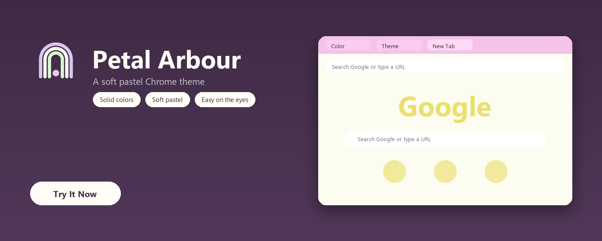
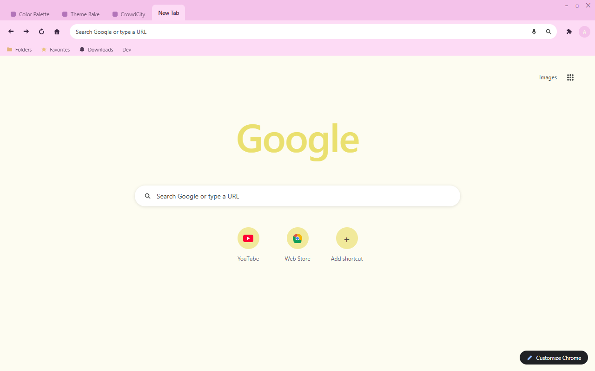
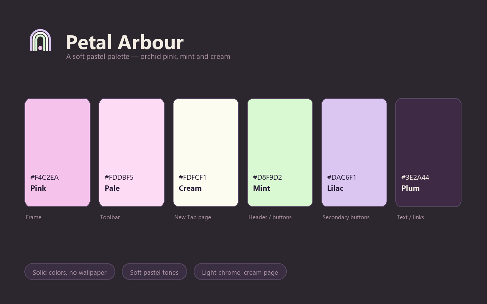

<p align="center">
  
</p>

<h1 align="center">Petal Arbour Theme</h1>

<p align="center">
  A soft pastel Chrome theme: orchid-pink chrome, a cream New Tab Page, and mint and lilac accents.
</p>

<p align="center">
  
  
  
  
</p>

<p align="center">
  
</p>

## Overview

Petal Arbour is the softest theme in the set: an orchid-pink frame, a pale pink toolbar, and a near-white cream New Tab Page with a muted yellow Google mark that never shouts. Deep plum ink keeps every tab, bookmark and toolbar icon readable on the light chrome, mint and lilac carry the buttons, and the whole thing stays in one airy pastel register.

The name comes from the reference art — an arch (an arbour) with a sun inside and a frond drooping across it — which is also the shape of the app icon.

## Design Concept

Six pastels from the reference palette are almost identical in lightness, so a theme built on them alone would blur into one flat wash. Three deliberate moves keep it legible:

1. **Split the surfaces by lightness** — the pink frame is the darkest of the set, the toolbar one step lighter, the page near-white.
2. **Add one colour from outside the palette** — deep plum `#3E2A44` for all chrome ink and page text (8.5:1 on the frame, 12:1+ on the page).
3. **Let the accents stay small** — mint only on buttons and the New Tab header, lilac only on secondary buttons.

| Color | Hex | RGB | Role |
|---|---|---|---|
| Pink | `#F4C2EA` | 244, 194, 234 | Frame |
| Pale | `#FDDBF5` | 253, 219, 245 | Toolbar |
| Cream | `#FDFCF1` | 253, 252, 241 | New Tab background |
| Mint | `#D8F9D2` | 216, 249, 210 | New Tab header / buttons |
| Lilac | `#DAC6F1` | 218, 198, 241 | Secondary buttons |
| Plum | `#3E2A44` | 62, 42, 68 | Chrome ink / page text |
| Berry | `#9C5AA8` | 156, 90, 168 | New Tab links |

## Features

- Pure color, no wallpaper — fast and distraction-free
- Soft pastel palette: orchid pink, pale pink, cream, mint and lilac
- Light chrome with deep plum ink — 8.5:1 on the frame
- Tab text, bookmark text and toolbar icons all share the same plum ink
- Single-row shortcut row and a color-matched Google mark for a clean New Tab Page
- No configuration needed — install and enjoy

## Screenshots

| Browser | Palette |
|:-:|:-:|
|  |  |

## Installation

### Load unpacked (development)

1. Download or clone this repository.
2. Open `chrome://extensions` in Chrome.
3. Enable **Developer mode** in the top right.
4. Click **Load unpacked** and select this folder (`petal-arbour-theme`).
5. The theme is active immediately.

### Package for the Chrome Web Store

```
chrome://extensions → Pack extension → select this folder → petal-arbour-theme.zip
```

Upload the resulting `.zip` to the [Chrome Web Store developer dashboard](https://chrome.google.com/webstore/devconsole).

## Store listing copy

Ready to paste into the store listing (also kept in `store-assets/store-description.txt`):

> Petal Arbour is a soft pastel Chrome theme: an orchid-pink frame, a pale pink toolbar, and a near-white cream New Tab Page with a muted yellow Google mark. Deep plum ink keeps every tab, bookmark and toolbar icon readable on the light chrome, with mint and lilac accents. Solid colors only, no wallpaper.

## Project structure

| File | Purpose |
|---|---|
| `manifest.json` | Theme definition (single-file, inlined `theme` field) |
| `logo/logo.png` | 128×128 store icon (transparent background) |
| `store-assets/promo/440x280.png` | Small promo tile |
| `store-assets/promo/1400x560.png` | Marquee promo tile |
| `store-assets/screenshots/en/screenshot-1-browser.png` | Browser mockup screenshot (1280×800) |
| `store-assets/screenshots/en/screenshot-2-palette.png` | Palette introduction screenshot (1280×800) |
| `store-assets/store-description.txt` | Store listing description |
| `scripts/generate-logo-vector.py` | Render all SVG logo candidates with headless Chromium, export `logo/logo.png` from `SELECTED` |
| `scripts/generate-screenshot-headless.py` | Regenerate the browser mockup via Playwright |
| `scripts/generate-screenshot-2-palette.py` | Regenerate the palette screenshot |
| `scripts/generate-promo.py` | Regenerate both promo tiles (1400×560 window hero, 440×280 dot palette) |
| `LICENSE` | Non-Commercial License (English / 中文) |

## Regenerating assets

Every asset is code-generated, so nothing here is hand-drawn or hand-copied:

```bash
py -3 scripts/generate-logo-vector.py         # candidates + logo/logo.png
py -3 scripts/generate-screenshot-headless.py # store screenshot 1 (browser mockup)
py -3 scripts/generate-screenshot-2-palette.py # store screenshot 2 (palette)
py -3 scripts/generate-promo.py               # promo 440x280 + 1400x560
```

To ship a different icon candidate, change `SELECTED` at the top of `generate-logo-vector.py` and re-run, then re-run the three asset scripts so the promo and screenshots pick up the new logo.

## License

Petal Arbour Theme is released under the Non-Commercial License. See `LICENSE` for full text (English / 中文).
